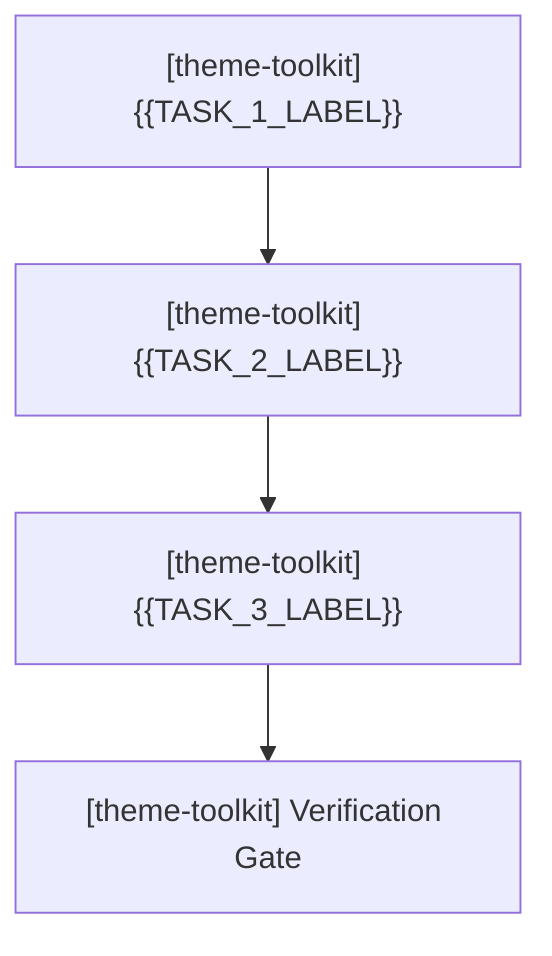

# theme-toolkit — Active Sprint Planning

> 🎯 **Living Source of Truth**: Active sprint roadmap, execution architecture, and completed sprint history for **theme-toolkit**.
> Pair with [`ROADMAP.md`](./ROADMAP.md) (direction), [`TODO.md`](./TODO.md) (task ledger), and [`BUGS.md`](./BUGS.md) (known issues).

> [!IMPORTANT]
> AI agents are strictly required to update this page and related tracking ledgers **before** executing new feature work or bug fixes and keep them synchronized.

---

## 📜 Tracking Rules

- **No Typo Duplication**: When recording user reports, clean and fix all typos to preserve professional quality.
- **Consistent Formatting**: Maintain consistent formatting and style throughout all documentation to ensure readability and professionalism.
- **Clear Sectioning**: Use clear and descriptive headers for each section to improve navigation and readability.
- **Active Items First**: The currently active milestone, sprint, task, or workstream must always be placed at the top of the content sections.
- **Active Sprints Only in Top Section**: `## 🎯 Active Sprints` must contain ONLY the currently active sprint(s). Once a sprint is completed, move it immediately to `## ✅ Completed Sprints` (newest first).
- **Regular Updates**: Ensure that this file is regularly updated to reflect the latest developments and changes in the project.
- **100% Active Direction Accuracy**: Continuously refine and synchronize sprint tasks with the current active direction of each project; immediately update or remove superseded tasks rather than leaving contradictory statements.
- **Full History**: Every planned item from project history is represented under `## ✅ Completed Sprints`, newest first.
- **Explicit Project Tagging**: In multi-project or organization tracking ledgers, every sprint header, task, and execution deliverable MUST be explicitly prefixed with its current project name and repository path (e.g., `[theme-toolkit] (theme-toolkit)`) to prevent agent context confusion.
- **Tracking Docs Stay True**: Update `ROADMAP.md`, `TODO.md`, `BUGS.md`, and `PLAN.md` first or in lockstep with code changes.
- **Always Track Everything**: Every new feature request, enhancement, or bug report must be logged before execution.

---

## 🎯 Active Sprints

### 🚀 Sprint 1: [theme-toolkit] (theme-toolkit) — Foundation & Initial Architecture
- **Project Identifier:** `[theme-toolkit]`
- **Repository Path:** `theme-toolkit`
- **Target Objective:** Scaffold project structure, local agents, and tracking ledgers.



#### 📝 Execution Tasks

1. **[theme-toolkit] Initial Setup**:
   - `[theme-toolkit]` Setup project configuration
   - `[theme-toolkit]` Verify test and build gate
2. **[theme-toolkit] {{TASK_2_NAME}}**:
   - `[theme-toolkit]` {{SUBTASK_2_A}}
   - `[theme-toolkit]` {{SUBTASK_2_B}}
3. **[theme-toolkit] {{TASK_3_NAME}}**:
   - `[theme-toolkit]` {{SUBTASK_3_A}}
   - `[theme-toolkit]` {{SUBTASK_3_B}}

---

## 🔮 Planned Sprints

### ⏳ Sprint {{NEXT_SPRINT_ID}}: [theme-toolkit] (theme-toolkit) — {{NEXT_SPRINT_TITLE}}
- **Project Identifier:** `[theme-toolkit]`
- **Repository Path:** `theme-toolkit`
- `[theme-toolkit]` {{CANDIDATE_ITEM_1}}
- `[theme-toolkit]` {{CANDIDATE_ITEM_2}}

---

## ✅ Completed Sprints

### ✅ Sprint {{PREV_SPRINT_ID}}: [theme-toolkit] (theme-toolkit) — {{PREV_SPRINT_TITLE}} ({{COMPLETED_DATE_OR_VERSION}})
- **Project Identifier:** `[theme-toolkit]`
- **Repository Path:** `theme-toolkit`
- ✅ `[theme-toolkit]` {{COMPLETED_ACTION_1}}
- ✅ `[theme-toolkit]` {{COMPLETED_ACTION_2}}
- ✅ **Verification**: {{VERIFICATION_OUTCOME}}

---

## 🛠️ Verification Commands

```powershell
# Commands used to test and verify sprint changes
{{VERIFICATION_COMMANDS}}
```

---

## 🔖 Metadata

- **Project**: theme-toolkit
- **Tracking Mode**: {{SEMVER_OR_MILESTONES}}
