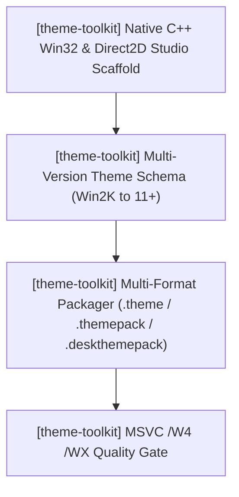

# theme-toolkit — Active Sprint Planning (Theme Studio)

> 🎯 **Living Source of Truth**: Active sprint roadmap, execution architecture, and completed sprint history for **theme-toolkit** (**Theme Studio**).
> Pair with [`ROADMAP.md`](./ROADMAP.md) (direction), [`TODO.md`](./TODO.md) (task ledger), and [`BUGS.md`](./BUGS.md) (known issues).

---

## 📜 Tracking Rules

- **100% Active Direction Accuracy**: Reflect the current, active direction of Theme Studio with zero contradictions.
- **Active Sprints Only in Top Section**: `## 🎯 Active Sprints` contains only the currently active sprint. Completed sprints move immediately to `## ✅ Completed Sprints` (newest first).
- **Mandatory Quality Gate**: Compilers and typecheckers must pass with zero errors and zero warnings (`MSVC /W4 /WX`).

---

## 🎯 Active Sprints

### 🚀 Sprint 1: [theme-toolkit] — Native Windows C++ Architecture & Rebrand to Theme Studio (v1.0.0, W.01)
- **Project Identifier:** `[theme-toolkit]`
- **Repository Path:** `projects/theme-toolkit`
- **Target Objective:** Abandon the experimental Tauri v2 rewrite. Rebrand to **Theme Studio**. Scaffold and implement the native C++20 Win32 desktop theme studio targeting Windows exclusively, supporting every Windows release from **Windows 2000 up to Windows 11+**. Build the Direct2D theme editor and multi-format packager (`.theme`, `.themepack`, `.deskthemepack`).

#### 📝 Execution Tasks

1. **[theme-toolkit] Native C++ Win32 & Direct2D Studio**:
   - `[theme-toolkit]` Establish native CMake / MSVC project structure targeting C++20 standard with `/W4 /WX`.
   - `[theme-toolkit]` Implement hardware-accelerated Direct2D studio canvas and dark mode frame.
2. **[theme-toolkit] Multi-Version Theme Schema & Token Engine (Win 2000 → 11+)**:
   - `[theme-toolkit]` Support classic SysColors, metrics, and `.theme` formats for Windows 2000 / XP.
   - `[theme-toolkit]` Support Aero parameters, colorization, and desktop slideshows for Windows Vista / 7.
   - `[theme-toolkit]` Support modern accent palettes, dark/light modes, and Mica/Acrylic accents for Windows 10 / 11+.
3. **[theme-toolkit] Multi-Format Packager Engine**:
   - `[theme-toolkit]` Author legacy `.theme` generator.
   - `[theme-toolkit]` Author Windows 7 `.themepack` packager via `makecab.exe`.
   - `[theme-toolkit]` Author modern Windows 8/10/11+ `.deskthemepack` packager via `makecab.exe`.
4. **[theme-toolkit] Quality Gate & Packaging**:
   - `[theme-toolkit]` Enforce zero compiler warnings under MSVC `/W4 /WX`.
   - `[theme-toolkit]` Verify generated theme archives apply cleanly across Windows targets.

---

## ✅ Completed Sprints

- _(Initial sprint in progress)_
