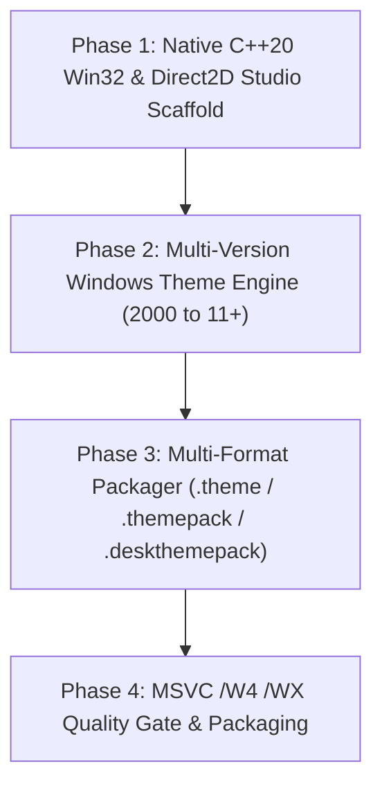

# theme-toolkit — Roadmap & Milestones (Theme Studio)

> 🗺️ **Living Source of Truth**: Product direction, positioning principles, and milestone delivery history for **theme-toolkit** (**Theme Studio**).
> Pair with [`PLAN.md`](./PLAN.md) (sprint execution), [`TODO.md`](./TODO.md) (task ledger), and [`BUGS.md`](./BUGS.md) (issues and quirks).

---

## 📜 Tracking Rules

- **100% Active Direction Accuracy**: `ROADMAP.md`, `PLAN.md`, `TODO.md`, and `BUGS.md` reflect the current, active direction of Theme Studio with zero contradictions.
- **Self-Contained Repository Memory**: This repository tracks its own product roadmap and development sprints independently.
- **Mandatory Quality Gate**: Zero compiler warnings under MSVC `/W4 /WX`.
- **License**: Strictly licensed under **MIT**.

---

## 🔭 Vision & Positioning Principles

1. **Core Value Proposition**: A native C++ Windows desktop theme studio and applicator (**Theme Studio**). Rebranded from Theme Toolkit as part of its native C++ rewrite. Tauri v2 abandoned; focused exclusively on pure native Windows execution with comprehensive support for **everything from Windows 2000 all the way to Windows 11+**.
2. **Design Principles**:
   - **Universal Windows Version Spectrum (2000 → 11+)**:
     - Windows 2000 / XP: Classic `.theme` files, SysColors, metric configurations, and `.msstyles` compatibility.
     - Windows Vista / 7: Aero glass parameters, `.themepack` archives, desktop slideshows, custom sound events.
     - Windows 8 / 8.1: Flat accent colorization, modern `.deskthemepack` CAB packaging.
     - Windows 10 / 11+: Modern `.deskthemepack`, dark/light theme switching, accent palette harmonies, and Mica/Acrylic backdrop awareness.
   - **Pure Native Windows Application**: High-performance C++20 Win32 application with Direct2D/DirectWrite canvas.
   - **Multi-Format Native Packager**: Generates compliant legacy `.theme`, Windows 7 `.themepack`, and Windows 8/10/11+ `.deskthemepack` archives via MSVC `makecab.exe` directives.
3. **Non-Goals & Boundaries**:
   - No cross-platform support (Windows-only native desktop execution).

---

## 🗺️ Milestone Overview

| # | Milestone | Scope | Status | Version / Target | Focus |
|---|---|---|---|---|---|
| **M1** | [theme-toolkit] Native Windows C++ Architecture & Rebrand to Theme Studio | Win 2K → 11+ | 🚀 Active | `v1.0.0` | Pure native C++20 Win32 app, Direct2D studio canvas, multi-version theme engine (`.theme`, `.themepack`, `.deskthemepack`) |
| **M2** | [theme-toolkit] Advanced Cursor & Sound Studio | Studio tools | ⏳ Planned | `v1.1.0` | Native cursor (.cur/.ani) editor, sound scheme mapper, live Windows applicator across OS versions |

---

## 🚀 Active Milestones

### [theme-toolkit] — Milestone M1: Native Windows C++ Architecture & Rebrand to Theme Studio (v1.0.0)

> **Strategic Directive:** Abandon Tauri v2. Rebrand to **Theme Studio** and build as a pure native C++20 Windows desktop application targeting Windows exclusively, supporting the full version spectrum from Windows 2000 up to Windows 11+.

#### Detailed Deliverables

- 🎯 **[theme-toolkit] Native C++20 Studio**: Lean Win32 desktop application with Direct2D hardware-accelerated canvas.
- 🎯 **[theme-toolkit] Multi-Version Windows Theme Engine**: Author and edit themes for Windows 2000, XP, Vista, 7, 8, 8.1, 10, and 11+.
- 🎯 **[theme-toolkit] Multi-Format Native Packager**: Generates legacy `.theme`, Windows 7 `.themepack`, and modern Windows 11 `.deskthemepack` bundles via `makecab.exe`.
- 🎯 **[theme-toolkit] Quality Gate**: MSVC `/W4 /WX` zero-warning enforcement.
